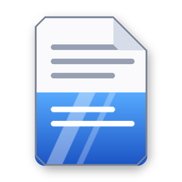
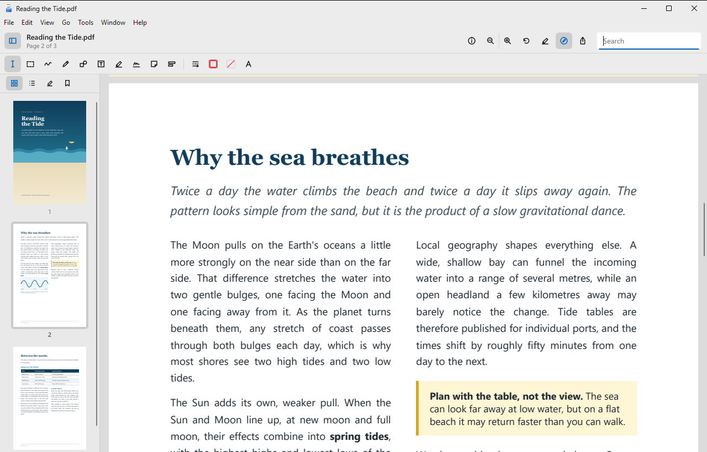
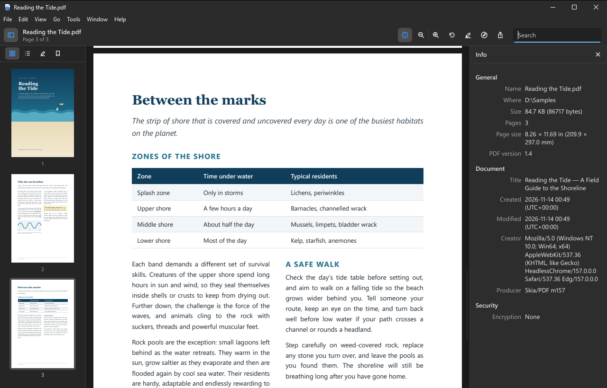
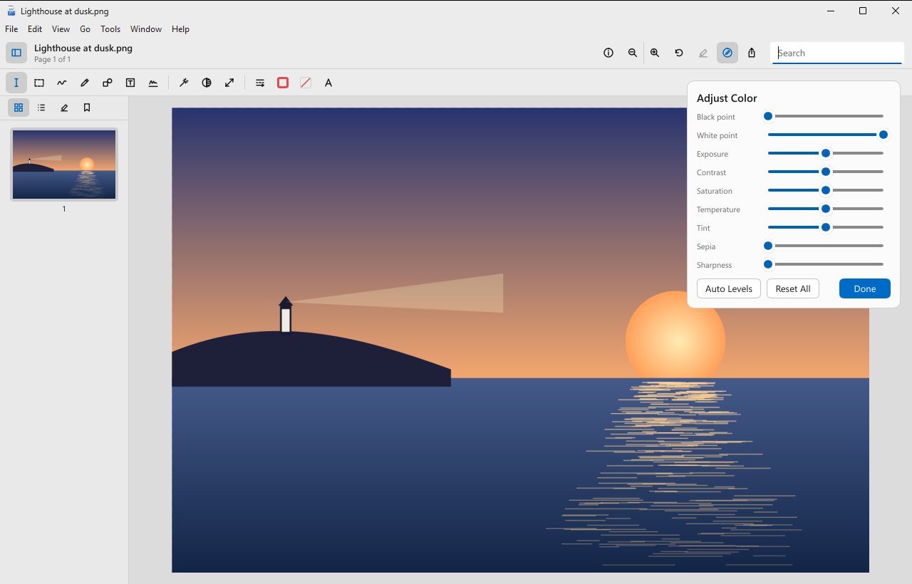
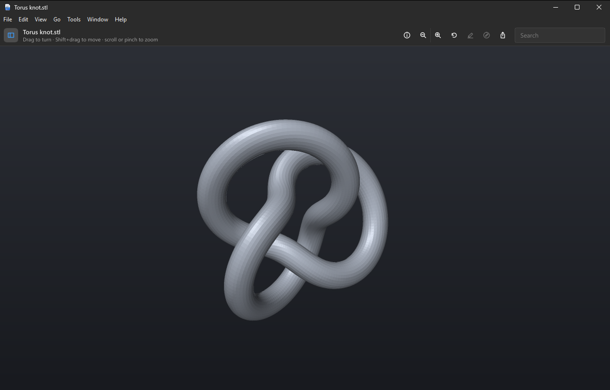

# Paper Mirror

<p align="center">
  
</p>

<p align="center">
  <a href="https://github.com/rvenning/paper-mirror/actions/workflows/build.yml"></a>
  <a href="https://github.com/rvenning/paper-mirror/releases/latest"></a>
  
  
  <a href="LICENSE"></a>
</p>

Paper Mirror is a free, open-source **PDF, image and 3D viewer and editor for
Windows 11**, inspired by macOS Preview. Open a PDF and mark it up, fill in a form,
sign it, reorganise its pages or redact it. Open a photo and crop, resize or colour-correct
it. Open a 3D model and turn it in your hands. Everything happens in one small, fast window.

It is a native Rust app, built with [Slint](https://slint.dev) and
[PDFium](https://pdfium.googlesource.com/pdfium/). It opens a typical PDF in about a
quarter of a second, installs without administrator rights, and **never connects to
the internet**: no account, telemetry, update checks or background services.

**[Website](https://rvenning.github.io/paper-mirror/)** ·
**[Download the latest release](https://github.com/rvenning/paper-mirror/releases/latest)** ·
**[Frequently asked questions](#frequently-asked-questions)** ·
**[Privacy and security](SECURITY.md)** ·
**[Changelog](CHANGELOG.md)**

Paper Mirror is independent software and is not affiliated with or endorsed by Apple.

## Screenshots

<p align="center">
  
  
</p>
<p align="center">
  
  
</p>

## Highlights

- **PDFs:**
  - continuous, single-page and two-page views, with thumbnails, table of contents,
    bookmarks, search, contact sheet, slideshow and magnifier;
  - pages stay sharp at any zoom.
- **Markup:**
  - highlight, underline and strike through text;
  - sketch (rough shapes are tidied up), draw, add shapes, text boxes, notes and
    signatures.
  - Annotations are standard PDF annotations, editable after saving.
- **True redaction** removes the marked text, images and graphics from the file
  instead of hiding them.
- **Forms and signatures:** fill in PDF forms; signatures are drawn or traced from an
  image and stored encrypted for your Windows account.
- **Pages:** rotate, reorder, delete, insert, combine and crop. Export as PDF with
  effects, a smaller file size or a password.
- **Images:**
  - PNG, JPEG, GIF, TIFF, BMP, ICO, WebP, OpenEXR, JPEG 2000 and HEIC/AVIF;
  - crop, flip, Adjust Size, Adjust Color, Instant Alpha, and EXIF with removable
    location;
  - colour profiles kept on save, and conversion between formats.
- **3D models:** STL, OBJ, PLY and glTF/GLB. Orbit, pan, zoom, fix the orientation, and
  export to the other formats or an image.
- **Windows:**
  - Print and Share, light and dark themes, your accent colour, and Windows 11's
    typeface;
  - touch and pen (pinch to zoom, draw with a finger or pen);
  - screen-reader support.
- **Safe with your files:** the original is kept before the first save over it
  (File > Revert To), and every file is treated as untrusted input.

## Requirements

- Windows 11, 64-bit (x64). Windows 10 isn't tested.
- About 35 MB of disk space.
- HEIC and AVIF photos need Microsoft's free HEIF and HEVC/AV1 extensions from the
  Microsoft Store. Everything else is built in.

## Install

### Installer

Download `PaperMirror-<version>-setup.exe` from the
[latest release](https://github.com/rvenning/paper-mirror/releases/latest) and run it.
- It installs for your account only, in `%LOCALAPPDATA%\Programs\Paper Mirror`, with no
  administrator rights.
- It adds a Start-menu shortcut. You can also make Paper Mirror the viewer for PDFs and
  images.
- To remove it, go to Settings > Apps.

### Portable

Unzip `PaperMirror-<version>-portable.zip` anywhere, a USB stick included, and run
`paper-mirror.exe`. Settings stay in a `data` folder beside the program.

### Check the download

Each release lists SHA-256 checksums in `SHA256SUMS.txt`:

```powershell
Get-FileHash .\PaperMirror-0.1.0-setup.exe -Algorithm SHA256
```

Releases aren't code-signed yet, so Windows SmartScreen may say it "protected your PC"
the first time. Choose **More info**, then **Run anyway**. On a PC with Smart App
Control turned on, unsigned programs can't run at all; use a signed release when one is
available.

## Frequently asked questions

### How is Paper Mirror different from opening PDFs in Edge?

Edge displays PDFs with drawing, highlighting and simple text. Paper Mirror is a document
workbench:
- shapes, text boxes and notes that stay editable;
- true redaction, form filling and stored signatures;
- page reordering, combining and cropping;
- image editing and a 3D viewer;
all in one window that works offline, without an account.

### Does Paper Mirror send any data anywhere?

No. It makes no network requests at all. There's no telemetry, crash reporting,
update check or online map, and it contains no networking code. Share hands a file to
the Windows Share sheet only when you pick a target. See
[Privacy and security](SECURITY.md).

### Will it change my files without asking?

No.
- Nothing is saved until you choose Save.
- Before Paper Mirror first saves over a file, it keeps the original
  (File > Revert To > Original).
- Closing a window with unsaved changes asks whether to save.

### Can I make it my default PDF viewer?

Yes. Choose **Help > Use Paper Mirror for PDFs and Images…**, then pick the file types
in Windows Settings > Default apps. Windows lets only you choose defaults, so Paper
Mirror never takes them over.

### Does it work with a touch screen, a pen or a screen reader?

Yes:
- One finger scrolls, two fingers pinch to zoom, and in a markup tool a finger draws.
- A pen selects and draws like a mouse.
- Narrator can read every control, the state of each tool, and the text of each page.

### Is it free? Can I use it at work?

Yes. Paper Mirror is free and open source under the [MIT licence](LICENSE), for
personal and commercial use. Third-party components are listed in
`THIRD-PARTY-NOTICES.txt`.

### Is this related to Apple Preview?

No. Paper Mirror is an independent project inspired by how Preview works. It contains
no Apple code or artwork.

## Build from source

Paper Mirror builds with Rust's `x86_64-pc-windows-gnullvm` toolchain and
[llvm-mingw](https://github.com/mstorsjo/llvm-mingw), so Visual Studio isn't needed.
1. Install [Rust](https://rustup.rs). `rust-toolchain.toml` pins the toolchain.
2. Unpack llvm-mingw 20261104 (UCRT, x86_64) and put its `bin` folder on `PATH`.
3. Build and run:

   ```powershell
   git clone https://github.com/rvenning/paper-mirror.git
   cd paper-mirror
   .\scripts\fetch-pdfium.ps1   # pinned PDFium build, checksum verified
   cargo run -- some.pdf
   cargo test                   # unit, backend and headless UI tests
   .\scripts\package.ps1        # installer, portable zip and notices in dist\
   ```

Signing a release and publishing it are covered in [RELEASING.md](RELEASING.md).
Contributions are welcome: see [CONTRIBUTING.md](CONTRIBUTING.md).

## Documentation

- [Decision records](docs/decisions/): why the toolchain, UI framework, PDF engine,
  saving, images, packaging, signing, touch, accessibility and window chrome work the
  way they do.
- [Feature checklist](docs/feature-checklist.md): every requirement, with the test that
  proves it.
- [Known limitations](docs/known-limitations.md): what doesn't work yet, or differs from
  Preview.
- [Performance](docs/performance.md): measured start-up, rendering and memory.

## Licence

Paper Mirror is released under the [MIT licence](LICENSE).
- Slint is used under its Royalty-free licence 2.0. Its attribution is in Help > About.
- PDFium is BSD-3-Clause, with bundled libraries under their own licences.
- `THIRD-PARTY-NOTICES.txt`, generated by `cargo run --example notices`, lists every
  component.
